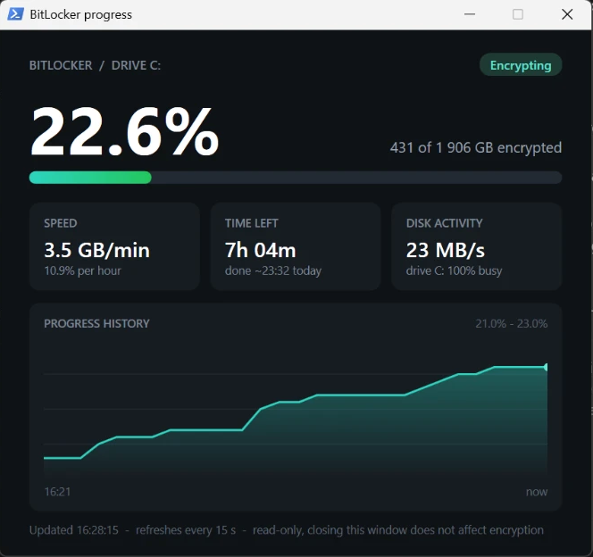

# BitLocker Progress Window

A small, read-only window that shows how far BitLocker encryption of drive C: has got, how fast it's going, and when it should finish.

Windows doesn't really show this. The built-in progress window often disappears after a restart, and `manage-bde -status` only gives you a bare percentage in a terminal. Encrypting a big drive can take many hours and make the PC sluggish the whole time, so it helps to see what's going on.



## What it shows

- **Percentage and progress bar**, plus how many GB of the drive are done
- **Speed** in GB per minute and % per hour, measured over the last 15 minutes
- **Time left**, with an estimated finish time ("done ~00:32 tomorrow")
- **Disk activity** of the drive holding C: (MB/s and % busy), so you can see why things feel slow
- **A history chart** of progress over the last 24 hours. It's saved, so it survives closing and reopening the window.
- **A status badge**: Encrypting, Paused, Finished, or **"Encrypting (says paused)"** when BitLocker reports "Paused" but the percentage keeps going up

It refreshes every 15 seconds.

## How to use it

1. Download or clone this folder.
2. Double-click **`Open BitLocker Progress.cmd`**.
3. Click **Yes** on the Windows admin prompt. Admin rights are needed only to read the BitLocker status.

To preview it without admin rights or an ongoing encryption, run it in demo mode with fake data:

```
powershell -NoProfile -ExecutionPolicy Bypass -STA -File BitLockerProgress.ps1 -Demo
```

## Is it safe?

- **Read-only.** It runs `manage-bde -status C:` and reads Windows disk performance counters. It never pauses, resumes, turns off or changes encryption, and closing the window has no effect on BitLocker.
- **One file of plain PowerShell** (`BitLockerProgress.ps1`). Nothing is downloaded and nothing is sent anywhere. Read it before running it.
- It writes one file, `history.csv`, next to the script, holding timestamps and percentages for the chart.

## Requirements

- Windows 10 or 11 with BitLocker (Pro, Enterprise or Education, or "Device encryption" on Home)
- Windows PowerShell 5.1 (built into Windows)
- An English Windows display language: the script reads the English text of `manage-bde -status`

## Good to know about BitLocker

- **Pausing doesn't survive a restart.** Microsoft's [BitLocker FAQ](https://learn.microsoft.com/en-us/windows/security/operating-system-security/data-protection/bitlocker/faq) says encryption resumes where it stopped the next time Windows starts. So `manage-bde -pause C:` only lasts until the next restart.
- **"Paused" can be wrong.** On the machine this was built on, `manage-bde -status` kept saying "Encryption Paused" after a restart while the percentage kept rising and the disk stayed 100% busy. Pausing again was refused with "already paused". The window flags this case with the yellow "Encrypting (says paused)" badge.
- Encryption only runs while the PC is awake, so leave it plugged in and awake overnight to get it done.

## Limitations

- Only watches drive C:.
- Speed and time left show "measuring..." for about the first minute, until there are two readings to compare.
- Time left is an estimate. Speed changes with what else the disk is doing.

## License

MIT. See [LICENSE](LICENSE).
